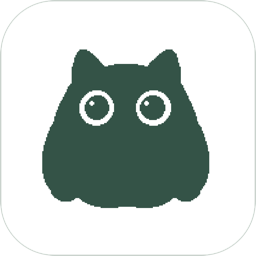
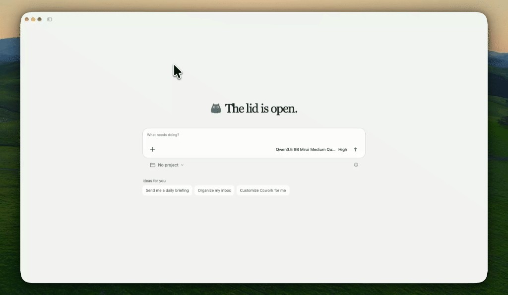
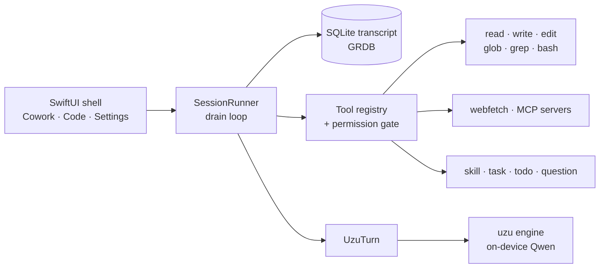

<div align="center">



# Yuzu

**A local AI workspace for your Mac.**<br/>
Chat, write, and code with a model that runs entirely on your machine.

[](#requirements)
[](#requirements)
[](https://swift.org)
[](https://github.com/trymirai/uzu)
[](LICENSE)

**[Download for Mac](https://github.com/adityachauhan0/yuzu/releases/latest/download/Yuzu.dmg)** · [Website](https://adityachauhan0.github.io/yuzu/) · [Releases](https://github.com/adityachauhan0/yuzu/releases)

<br/>



</div>

<br/>

Yuzu is a native SwiftUI app wrapped around a real agent harness. Ask it for a poem and it writes one. Point it at a folder and it reads, edits, and runs commands there, asking first. The model, the transcript, and your files stay on your Mac.

## Highlights

|   |   |
|---|---|
| 🐱 **Fully local** | Inference runs on [uzu](https://github.com/trymirai/uzu) on Apple Silicon. Yuzu picks the largest Mirai-quantized chat model that fits in half your RAM and downloads it to uzu's cache on first launch. No weights ship in the app. |
| ✍️ **Cowork** | A quiet page for everyday work: drafting, summaries, ideas, questions. Tasks run in a private sandbox folder. |
| 🧑‍💻 **Code** | Open any folder and work on it. Threads are grouped by workspace in the sidebar. |
| 🔐 **Permissions you control** | Cycle between **Workspace Read** (ask before edits and shell), **Workspace Write** (edits allowed, shell asks), and **YOLO** (no prompts). The **Plan** agent can never edit or run commands. |
| ⚡ **Live turns** | Reasoning, text, and tool calls stream in as they happen. Replies render as Markdown with themed code blocks. |
| 📊 **Honest metrics** | Live context usage, decode tok/s (time to first token excluded), and the CPU and RAM used by the model process itself. |
| 🔌 **MCP built in** | Ask the agent to “install DuckDuckGo MCP” and it will add, connect, and use the server for you. |
| 🧩 **Skills and subagents** | Load skill instructions on demand, hand a sub-task to a subagent, track progress with a todo list. |

## How it works



Every message is written to SQLite before the next model turn, so a thread survives a crash or a relaunch. Each turn rebuilds a small, frozen baseline (project instructions, the skill list, workspace, date, MCP notes) and sends only what is new since the model last saw the session. Long threads compact themselves into a summary and keep the most recent messages verbatim.

### The pieces

| Path | What lives there |
|---|---|
| [`Sources/YuzuHarness`](Sources/YuzuHarness) | The engine: session loop, context, compaction, tools, permissions, MCP, skills, agents, schedules. No UI, no model dependency. |
| [`Sources/YuzuModel`](Sources/YuzuModel) | `UzuTurn`, the only file that imports uzu. It streams text, reasoning, and token stats back to the harness. |
| [`App/Yuzu`](App/Yuzu) | The macOS app: shell, sidebar, threads, settings, theme, and fonts. |
| [`Tests`](Tests) | Harness tests, plus live model tests behind environment flags. |

## Requirements

- An Apple Silicon Mac running **macOS 26.4** or later
- **Xcode** with the macOS 26.4 SDK
- [XcodeGen](https://github.com/yonaskolb/XcodeGen) if you add or move app source files
- Free disk space for the model. The 9B model is several GB, and uzu downloads it once.

## Install

1. Download **[Yuzu.dmg](https://github.com/adityachauhan0/yuzu/releases/latest/download/Yuzu.dmg)** and drag Yuzu into Applications.
2. This build is ad-hoc signed, so macOS asks before the first open. Go to **System Settings → Privacy & Security → Open Anyway**, or run:
   ```bash
   xattr -dr com.apple.quarantine /Applications/Yuzu.app
   ```
3. On first launch Yuzu downloads the model that fits your Mac, with progress in the model picker. If the download stops, click the model to try again.

## Build and run

```bash
git clone https://github.com/adityachauhan0/yuzu.git
cd yuzu

# Build the app
xcodebuild -project App/Yuzu.xcodeproj -scheme Yuzu -destination 'platform=macOS' build

# Or open it in Xcode and press ⌘R
open App/Yuzu.xcodeproj
```

The first launch downloads the advised model. After that, Yuzu starts offline.

> [!TIP]
> Added a new Swift file under `App/Yuzu`? Run `xcodegen generate` inside `App/` so the project picks it up.

## Make it yours

| What | Where |
|---|---|
| Project instructions | `YUZU.md` (or `AGENTS.md`) at the root of the folder you open |
| Project skills | `.yuzu/skills/<name>/SKILL.md` |
| Personal skills | `~/Library/Application Support/Yuzu/skills/<name>/SKILL.md` |
| MCP servers | `~/Library/Application Support/Yuzu/mcp.json`, or just ask the agent |

A skill is a Markdown file with a short header:

```markdown
---
name: release-notes
description: Use when the user asks for release notes from recent commits.
---

Read the last tag, list merged changes, and group them by area…
```

The agent sees only the name and description until it decides a skill fits, then loads the full text.

## Tests

```bash
# Harness tests
swift test

# App and window tests
xcodebuild -project App/Yuzu.xcodeproj -scheme Yuzu -destination 'platform=macOS' test

# Live model tests (downloads a model)
YUZU_EVAL_MODEL=1 swift test --filter LiveUzuTests
YUZU_LIVE_HARNESS_MODEL='alibaba:qwen3.5:9b:mirai:mirai-m:4' swift test --filter LiveHarnessTests
```

## Acknowledgements

- [uzu](https://github.com/trymirai/uzu) by Mirai for on-device inference
- [GRDB.swift](https://github.com/groue/GRDB.swift) for SQLite
- [OpenCode](https://github.com/anomalyco/opencode) for the harness ideas this one learned from
- [Inter](https://rsms.me/inter/), [Source Serif 4](https://github.com/adobe-fonts/source-serif), and [OpenDyslexic](https://opendyslexic.org), all under the SIL Open Font License (see [`App/Yuzu/Fonts`](App/Yuzu/Fonts))

## License

Yuzu is licensed under the [GNU AGPL-3.0](LICENSE). You can use, study, and modify it freely, as long as anything you build on it, including a hosted service, is released as open source under the same license.

<div align="center">
<br/>
<sub>Made on a Mac, for a Mac. The cat is in.</sub>
</div>
