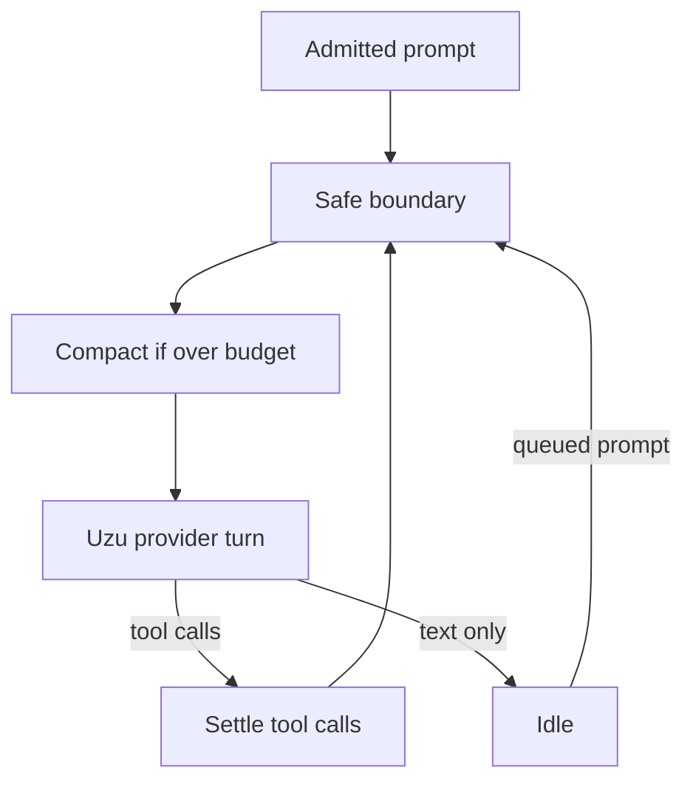

# Session loop

One session is one project directory, one agent, and the single loaded model. The loop is OpenCode’s session runner: history is already on disk, and a drain continues from it.

## Admission

The composer writes an inbox row and starts a drain if one is not running. The text is not model-visible yet. That lets the UI show “queued” and lets a failure before the first turn leave the prompt retryable.

Two inbox kinds:

- **Steer.** Promote at the next safe boundary even while tools are still running. Promoting any steered input resets the agent’s step counter once for that boundary.
- **Queue.** Promote only when the drain would otherwise go idle. Promote one, then decide again. Do not empty the queue in one go.

## One drain

`SessionRunner.run` does this until there is nothing left to do:

1. If a tool call from the previous assistant message has no result, settle it before any new model call. A crash between the call and the result resumes here.
2. At the boundary, promote eligible inbox input. Reconcile context sources. Compact if the projected history is over the budget. Details are in [Context](03-context.md).
3. Materialize the tool list for the current agent. Wholly denied tools are omitted. See [Tools](04-tools.md) and [Permissions](05-permissions.md).
4. Ask `UzuTurn` for one completion. Stream tokens to the client. Persist the assistant message as it grows, replacing the same row until a finish reason.
5. If the assistant message has tool calls, settle each one, append results, and go back to step 1. If it does not, stop unless a queued prompt is waiting.

The step limit comes from the agent (`steps` on the agent document). On the last allowed step the runner takes one more turn with tools withheld and a fixed instruction to summarize in text. If the model’s capabilities say `requires_tools`, the schemas stay on the request and any call comes back as a tool error: “tools disabled this step.”

## Cancel

Cancel aborts the uzu stream and any running tool. If the stored assistant message contains tool calls without results, delete that assistant message from history and mark the epoch cache dirty so the next turn resets uzu and replays. The transcript must never contain a tool call without a later result.

## What the model sees versus what the UI sees

History stores every message. The provider projection drops mid-conversation system messages from earlier epochs, drops native reasoning signatures after a model reload, and replaces oversized tool output with the capped form plus a path to the full file. The transcript UI shows user text, assistant text, reasoning, tool calls, and tool results. It hides epoch bookkeeping.
